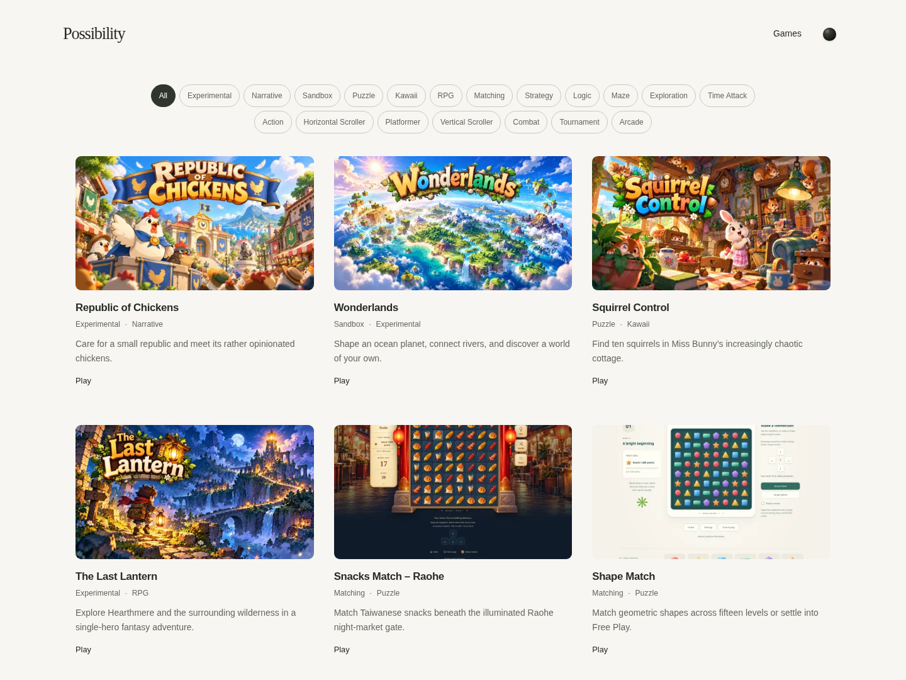
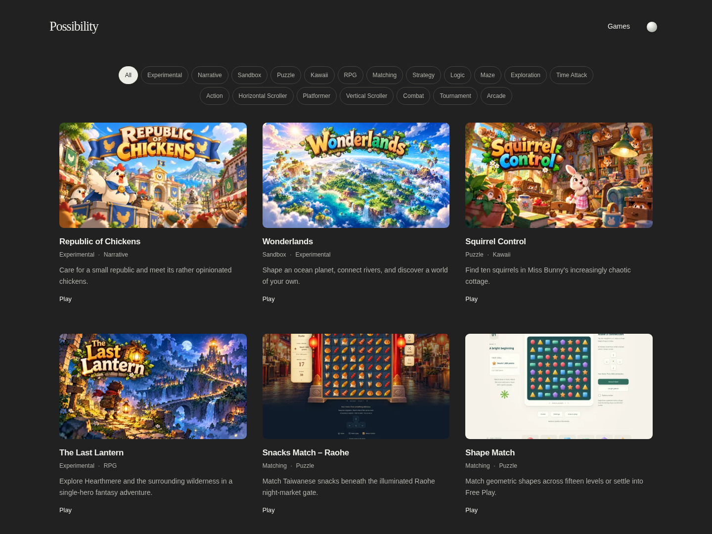

# Approved cover batch 01

Four owner-approved artworks are integrated through the existing custom-cover pipeline. This change adds three publishing WebPs, archives all four supplied PNG masters, and records validation. It changes no project metadata, ordering, layout, client behavior, builder, game repository or deployment policy.

## Originals and provenance

The supplied ZIP's [manifest.json](manifest.json), [README.txt](README.txt), and [masters/](masters/) are archived byte-for-byte. All four master SHA-256 checksums and 1672×941 dimensions match the manifest. [provenance.json](provenance.json) records the publishing sources, hashes and decisions; [image-proof.json](image-proof.json) records generated URLs, fingerprints, dimensions and byte sizes.

Republic of Chickens uses the same approved scene, composition, characters and blue/gold title treatment as the existing POC. Its existing 1280×720 WebP is retained **byte-for-byte**, as requested. It is not pixel-identical to the supplied higher-resolution PNG: the retained source was decoded losslessly from the earlier JPG. The new PNG master is archived without replacing that working publishing source.

The other three PNGs were converted to lossless WebP at their original 1672×941 dimensions. Decoded RGB pixels were compared and are identical. No artwork generation, retouching, title editing, compositional cropping or upscaling was performed. These lossless publishing sources are repository inputs; visitors receive the builder's existing optimized WebP variants, not these multi-megabyte source files or the archived PNGs.

| Project | Publishing source | Result |
| --- | --- | --- |
| Republic of Chickens | `public/assets/covers/games/republic-of-chickens.webp` | Existing asset retained |
| Wonderlands | `public/assets/covers/games/wonderlands.webp` | Added |
| Squirrel Control | `public/assets/covers/games/squirrel-control.webp` | Added |
| The Last Lantern | `public/assets/covers/games/the-last-lantern.webp` | Added |

Existing 16:9 delivery normalization rounds the 1672×941 sources by at most 0.5 original pixel vertically. No meaningful composition or lettering is removed. The original publishing sources retain every pixel. The new sources produce 480×270, 960×540 and 1600×900 variants; the retained Republic cover produces 480×270 and 960×540. All output hashes match their URL fingerprints, with no output enlarged beyond its input.

## Actual gallery screenshots

Each linked gallery capture includes all four approved covers in unchanged gallery order. The canvas extends vertically to show the relevant rows; widths, card dimensions and responsive column rules are unchanged. Native-size mobile and narrow artwork captures are also in [screenshots/](screenshots/).

| Width | Light | Dark |
| --- | --- | --- |
| Desktop 1440px / 3 columns | [Screenshot](screenshots/desktop-light.png) | [Screenshot](screenshots/desktop-dark.png) |
| Tablet 768px / 2 columns | [Screenshot](screenshots/tablet-light.png) | [Screenshot](screenshots/tablet-dark.png) |
| Mobile 390px / 1 column | [Screenshot](screenshots/mobile-light.png) | [Screenshot](screenshots/mobile-dark.png) |
| Narrow 320px / 1 column | [Screenshot](screenshots/narrow-light.png) | [Screenshot](screenshots/narrow-dark.png) |

Visual inspection confirms that each title treatment remains readable at actual desktop (~379px), tablet (348px), mobile (350px), and narrow (280px) artwork widths. Fine scenic details and small words such as the Republic banner's “OF” become less prominent at the smallest size; the unchanged HTML project title remains fully readable below every cover. The complete title banners and principal subjects remain visible in both themes.

## Validation

`npm run check` passed: strict TypeScript, lint/format checks, 12 content/publishing tests, 10 responsive/theme cases, 76 filter cases, 13 accessibility scans with **zero violations and zero incomplete checks**, 8 contrast checks, 11 behavioral scenarios and 5 isolated collection/editorial fixture routes. [test-results.json](test-results.json) preserves the browser results.

The additional [browser-proof.json](browser-proof.json) records 8 actual-gallery width/theme cases. Every approved project selects its custom cover ahead of the screenshot and retains its original destination. Eight fault injections cover each project's cover → screenshot and cover + screenshot → placeholder transitions, with Play intact. All passed. No horizontal overflow or JavaScript errors were observed. Local captures were made against the changed working tree based on `58d4afe`; the eventual committed source is separately validated by hosted CI's `release:check` before publication.

The original Republic WebP and all content, application code, builder, existing tests and active workflows were compared against the base commit and remain unchanged. [changed-files.txt](changed-files.txt) lists this batch's exact changed files.

## Publication status and repeatable owner workflow

Before integration, main and the review baseline both pointed to `58d4afe651d336c24887d3f048a7ee925b79d7f1`. GitHub records a successful manual [production release run 40634953866](https://github.com/jaychtw/jaychtw.github.io/actions/runs/40634953866) for that commit. This cloud session cannot independently fetch the public Pages site because its proxy denies that domain. No new batch deployment or live verification is claimed.

Automatic publication is still an inactive proposal outside `.github/workflows/`. Accordingly this batch stops at a validated commit on `platform/covers-batch-01`; main and the manual release gate are preserved. To publish, merge the validated batch, wait for the exact main commit's CI, then have an authorized owner run **Publish approved Possibility release** from main with that full SHA and `PUBLISH POSSIBILITY`. Require both jobs and public integrity/browser/destination checks to pass. The pre-platform rollback SHA `56f5a997ef12b66cce4948b770c92bc3e8c5db81` remains preserved; `58d4afe` is also retained as the pre-batch source.

For the next cover: archive the approved original, export WebP without changing its composition, replace `public/assets/covers/games/<project-id>.webp`, and commit through the same review/check/manual-publication flow. No JSON, checksum, layout or code changes are needed. [The owner guide](../MAINTENANCE.md#replace-artwork) includes the exact PNG-to-lossless-WebP command. Routine replacement does not require another integration project.
