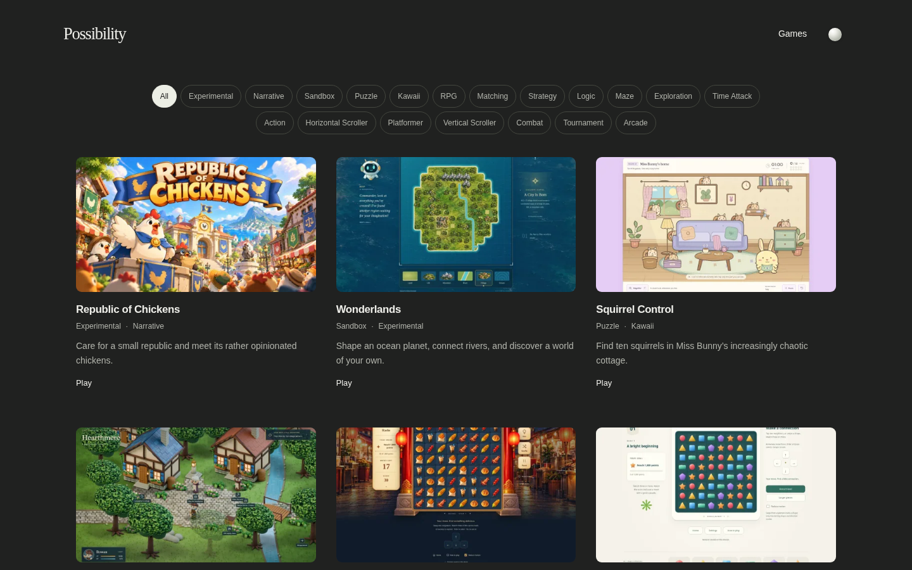
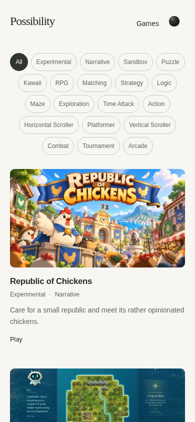

# Republic of Chickens — Cover Art POC v1 visual review

**The supplied 1651.jpg is now integrated on `platform/v1-rc` as a visual POC. Final creative approval is pending. No main merge, public deployment, production-gate change or independent game-repository modification was performed.** The earlier missing-file dependency is resolved.

The original [written request](request.md), [filter-only report before the attachment](filter-review-before-attachment.md) and its screenshot-only evidence remain preserved. The platform baseline is `f0d0a70`; the compact-filter refinement was validated at `6307495`. This update completes the actual artwork integration and review.

## Actual gallery previews

These are screenshots of the supplied cover in the actual gallery, using real project metadata and the unchanged card/grid layout. Other cards retain their authentic screenshots or neutral placeholders.

| Viewport / layout | Dark | Light |
| --- | --- | --- |
| Desktop 1440×900 / three columns | [Gallery](cover-integration/desktop-dark-after.png) · [Card at 1×](cover-integration/desktop-dark-card-1x.png) | [Gallery](cover-integration/desktop-light-after.png) · [Card at 1×](cover-integration/desktop-light-card-1x.png) |
| Tablet 768×1024 / two columns | [Gallery](cover-integration/tablet-dark-after.png) · [Card at 1×](cover-integration/tablet-dark-card-1x.png) | [Gallery](cover-integration/tablet-light-after.png) · [Card at 1×](cover-integration/tablet-light-card-1x.png) |
| Mobile 390×844 / one column | [Gallery](cover-integration/mobile-dark-after.png) · [Card at 1×](cover-integration/mobile-dark-card-1x.png) | [Gallery](cover-integration/mobile-light-after.png) · [Card at 1×](cover-integration/mobile-light-card-1x.png) |
| Narrow mobile 320×900 / one column | [Gallery](cover-integration/narrow-dark-after.png) · [Card at 1×](cover-integration/narrow-dark-card-1x.png) | [Gallery](cover-integration/narrow-light-after.png) · [Card at 1×](cover-integration/narrow-light-card-1x.png) |





The card and artwork-only crops use device scale 1, without enlargement. View images at **100%** when judging lettering. Approximate artwork dimensions are 379×213px desktop, 348×196px tablet, 350×197px mobile, and 280×158px narrow mobile. [Desktop artwork alone](cover-integration/desktop-dark-artwork-1x.png) · [Narrow artwork alone](cover-integration/narrow-light-artwork-1x.png).

## File integrity and delivery

- Original JPG: **1280×720**, exactly 16:9, 171,948 bytes. Preserved unchanged at [original/1651.jpg](original/1651.jpg); original SHA-256 is `d74a51327789d2a39b562bb5c9239c43a401837cf656689d3bbf8a524ddc6a95`.
- Custom source: `public/assets/covers/games/republic-of-chickens.webp`. Lossless encoding preserves the original JPEG's decoded RGB pixels exactly: no crop, resize, upscaling, regeneration, reinterpretation or artistic alteration.
- The lossless working source is 1,160,618 bytes and is intentionally larger than the compressed JPG. It is **not served directly by the generated site**; the existing builder supplies small responsive WebPs. No build, rendering or gallery architecture change was needed.

| Public derivative | Bytes | Full original frame preserved | Fingerprint |
| --- | --- | --- | --- |
| 480×270 WebP | 40,660 | Yes | `9a82c53512b7` |
| 960×540 WebP | 105,220 | Yes | `21e7788f657b` |

The 480px rendition is selected at the recorded 1× card sizes; a 2× desktop check selects 960px. No 1600px rendition is invented or upscaled from the 1280px source. Both derivative files match a direct, uncropped full-frame resize **byte for byte**, and their SHA-256 values match their generated URLs. The builder's generic evidence label says “16:9 center crop”; for this exact 16:9 source no cropping occurs.

[Original/conversion proof](cover-provenance.json) · [Actual priority, no-crop and fingerprint proof](cover-verification.json) · [Browser capture/2×/fallback receipt](cover-integration/receipt.json).

## Visual assessment at actual card sizes

- **Composition:** the complete blue-and-gold title banner and main white chicken retain a clear hierarchy. No additional cropping removes text or important characters; the original edge-framed foreground crowd remains as supplied. The native title, tags, description and Play action below the image remain balanced and readable.
- **Lettering:** “Republic” and “Chickens” remain readable at normal desktop/tablet/mobile card sizes, including the 280px-wide narrow case. The small “OF” and distant scene details naturally become less prominent at the narrowest size; the full native HTML title remains independently readable. No enlarged mockup is being substituted for the 1× assessment.
- **Spacing:** the existing whitespace supports the stronger cover without changing card size, grid spacing or typography. The cover fits the established component; no layout was tailored solely to this asset.
- **Mixed assets:** the POC has greater promotional presence than gameplay UI captures, as expected. The shared 16:9 frame and text hierarchy keep the mixed gallery coherent. Placeholder cards retain their honest neutral treatment. Additional approved covers can improve consistency incrementally without requiring matching illustration styles or a platform rebuild.
- **Themes:** the cover's bright sky, blue ribbon and warm lettering remain distinct on both charcoal and pale neutral backgrounds. Neither theme needs an extra frame, heavy shadow, backdrop or color treatment.

**Recommendation:** the cover system and current gallery are visually ready for the owner's production review. This is an engineering/visual recommendation, not final creative approval of the artwork or authorization to publish.

## Filter refinement retained

The earlier smallest effective adjustment remains: 36px minimum-height pills, 12px text at default sizing, 6px gaps, and reduced horizontal padding/margins. All remains selected initially; one tag hides complete nonmatching cards, closes gaps and preserves order. Keyboard focus, result announcements, contrast and all visible tags are retained. No search, collapse, overflow menu, multi-selection or navigation change was added.

| Viewport | Rows before → after | Filter height before → after | Artwork moves upward |
| --- | --- | --- | --- |
| Desktop 1440px | 2 → 2 | 92 → 78px | 24px |
| Tablet 768px | 3 → 3 | 142 → 120px | 22px |
| Mobile 390px | 6 → 5 | 287 → 204px | 87px |
| Narrow 320px | 7 → 7 | 336 → 288px | 52px |

The new capture set also contains `*-before.png` files: the same supplied artwork with the exact `f0d0a70` stylesheet, isolating the filter comparison. The full tag set still wraps substantially on narrow screens. A disclosure/overflow interaction is a separate recommendation requiring approval, and has not been implemented. Targets remain above the WCAG 2.2 AA 24px minimum, with less touch area than the original 42px controls; this is not a claim of full WCAG or physical-device certification.

## Validation and limits

| Check | Result |
| --- | --- |
| Lossless source conversion | Decoded RGB buffers identical to supplied JPG |
| Actual custom-cover priority | Cover chosen above the existing screenshot in all 16 viewport/theme/comparison captures |
| Frame, derivatives and fingerprints | Exact 16:9 source/output, no-crop equivalence, hash-to-URL checks passed |
| 2× rendering | Actual browser selected the 960px derivative |
| Actual-cover fault injection | Blocking cover restores the real screenshot; blocking both restores the monogram; original Play URL stays usable |
| TypeScript and lint/format | Passed |
| Catalog/security/publishing tests | 12 passed |
| Responsive/theme layouts | 10 passed at five widths in both appearances |
| Filter behavior | 76 cases passed |
| Accessibility | 13 axe scans, zero violations |
| Filter interaction contrast | Eight phase/theme checks passed |
| Interaction/resilience | 11 scenarios passed, including theme persistence, keyboard, emulated touch, reduced motion and image failure |

[Cover-to-screenshot fallback](cover-integration/fallback-screenshot-mobile.png) · [Final placeholder fallback](cover-integration/fallback-placeholder-mobile.png) · [Full local test receipt](cover-tests.json).

No application regression or baseline test failure was observed during this integration. The known synthetic invalid-cover warning is an intentional passing fallback test. The pre-existing tests' assumptions that owner-uploaded covers were absent were corrected in `6307495`; the real cover now passes that suite. No project metadata, descriptions, ordering, game repository, Markdown engine, production workflow or publication policy changed.

The artwork is an owner-supplied POC, not a newly certified gameplay screenshot or an assertion of nonexistent game features. Local Chromium, emulated viewport/touch, source/derivative checks and screenshot inspection establish the stated scope. Actual Safari/Firefox, physical-device play, subjective approval and universal title readability across every display are not certified. Final artwork approval and public deployment remain separate owner decisions.

## Review locally and release boundary

```sh
npm ci
npm run dev
```

Open **http://localhost:4173/**. **http://localhost:4173/games/** remains the compatibility URL. To reproduce the POC captures after building, run `node scripts/capture-cover-poc.cjs`; it temporarily uses local port 4180 and writes `.artifacts/cover-poc/cover-integration/`. Baseline comparison requires `f0d0a70` in local Git history.

[Exact changed files since the requested baseline](changed-files.txt). The current report, source artwork, and review captures are committed for GitHub access. CI validates the exact pushed SHA and packages a review artifact; it does not deploy. The candidate remains on `platform/v1-rc`. **Stop at owner review; do not merge or publish without separate authorization.**
