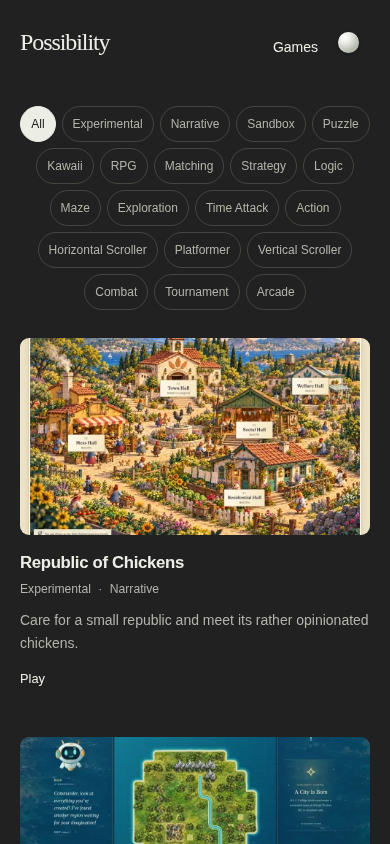

# Cover Art POC v1 — filter review; original artwork file pending

**Partial task, not completed cover validation.** The Republic of Chickens banner artwork is visible in the conversation, but its original image bytes were not exposed as a downloadable attachment or workspace file. Only the written request was downloadable. No artwork was regenerated, reconstructed, copied from an unrelated source, or substituted. The dedicated custom-cover path is still absent.

Attach the original PNG/JPG/WebP file, or provide its direct download URL, to finish faithful WebP conversion, custom-cover integration and actual-size artwork review. This report makes **no claim of final creative approval, title-banner legibility, noncropping, or successful integration of the supplied cover**.

## Completed independent work

The filter refinement uses smaller dimensions and slightly tighter spacing, retaining the existing outline, colors, selected state, focus treatment, contrast fix and all visible tags. No overflow/collapse interaction, menu, search, multi-selection or navigation change was introduced. Grid dimensions and card typography remain unchanged. Project metadata, descriptions, editorial ordering, Markdown behavior, game repositories and production release gate were not changed.

| Parameter | Baseline `f0d0a70` | Refined |
| --- | --- | --- |
| Minimum pill height | 42px | 36px |
| Font size | 12.8px desktop / 12.16px mobile | 12px at default text size |
| Horizontal padding | 17px desktop / 13px mobile | 12px desktop / 10px mobile |
| Between-pill gap | 8px desktop / 7px mobile | 6px |

Targets remain above the WCAG 2.2 AA 24px minimum; the tradeoff is less touch area than the former 42px controls. Focus remains visible and the separate theme control remains 44px. Text contrast remains unchanged. Inverse foreground/background pairs still switch together without low-contrast intermediate color animation.

## Measured visual effect

Actual Chromium layout, device scale **1**, the same genuine game screenshot in both modes. “Before” uses the exact baseline stylesheet on the same current gallery; this is a controlled filter comparison, not an assertion that the supplied cover existed in the baseline.

| Viewport | Filter rows before → after | Filter height before → after | First artwork moves upward |
| --- | --- | --- | --- |
| Desktop 1440px | 2 → 2 | 92 → 78px | 24px |
| Tablet 768px | 3 → 3 | 142 → 120px | 22px |
| Mobile 390px | 6 → 5 | 287 → 204px | 87px |
| Narrow 320px | 7 → 7 | 336 → 288px | 52px |

Card widths stay approximately **379 / 348 / 350 / 280px**, respectively. Each image remains 16:9. Light and dark theme measurements agree. On typical mobile width the complete first card is now visible sooner; tablet and desktop keep their two-/three-column composition.

The full tag set still occupies multiple rows, especially at 320px. A disclosure/overflow design could reduce this further, but that would change interaction and should be reviewed separately. The current small adjustment is sufficient to make the filters quieter without hiding browsing options.

## Actual rendered screenshots

**These show the existing authentic screenshot fallback, not the new cover POC.**

| Layout | Dark | Light |
| --- | --- | --- |
| Desktop, three columns | [After](filters-only/desktop-dark-after.png) · [Before](filters-only/desktop-dark-before.png) | [After](filters-only/desktop-light-after.png) · [Before](filters-only/desktop-light-before.png) |
| Tablet, two columns | [After](filters-only/tablet-dark-after.png) · [Before](filters-only/tablet-dark-before.png) | [After](filters-only/tablet-light-after.png) · [Before](filters-only/tablet-light-before.png) |
| Mobile, one column | [After](filters-only/mobile-dark-after.png) · [Before](filters-only/mobile-dark-before.png) | [After](filters-only/mobile-light-after.png) · [Before](filters-only/mobile-light-before.png) |
| Narrow mobile | [After](filters-only/narrow-dark-after.png) · [Before](filters-only/narrow-dark-before.png) | [After](filters-only/narrow-light-after.png) · [Before](filters-only/narrow-light-before.png) |

Normal-size first-card crops, without enlargement: [desktop dark](filters-only/desktop-dark-card-1x.png), [desktop light](filters-only/desktop-light-card-1x.png), [tablet dark](filters-only/tablet-dark-card-1x.png), [tablet light](filters-only/tablet-light-card-1x.png), [mobile dark](filters-only/mobile-dark-card-1x.png), [mobile light](filters-only/mobile-light-card-1x.png). Image viewers may scale these; inspect at 100% for the recorded CSS size.



[Measured layout receipt](filters-only/receipt.json) · [Exact changed files](changed-files.txt).

## Test scope and pre-existing assumptions

The existing publishing fixtures assumed no custom cover had been uploaded to the real portal. They now explicitly clear custom covers **only inside their isolated fixture directory**, so the synthetic replacement test always starts from its documented screenshot state. The production failure test now blocks both possible preview sources when checking the final placeholder; a valid custom cover must not be mistaken for a failed screenshot fallback. These are pre-existing test assumptions, not a change to cover priority or Markdown publishing behavior.

The applicable type, lint, catalog/publishing, browser, accessibility, contrast, theme persistence, filter and image-fallback checks are recorded in the exact candidate CI artifact. Synthetic fixture cover tests establish the technical override mechanism; they do not establish that the supplied artwork has been integrated. The [test receipt](tests.json) records actual local results. No newly introduced application regression or baseline test failure was observed in the completed local checks.

## Reproduce

```sh
npm ci
npm run build
node scripts/capture-cover-poc.cjs --filters-only
npm run check
npm run dev
```

Actual gallery: **http://localhost:4173/**; compatibility route: **http://localhost:4173/games/**. The capture command uses local port 4180 temporarily, then stops its server. Baseline comparison requires the `f0d0a70` commit in local Git history. Screenshots/metrics are generated under ignored `.artifacts/cover-poc/filters-only/` and copied here for GitHub review.

Once the original image is available, use the exact source path `public/assets/covers/games/republic-of-chickens.webp`, preserve the full composition and rerun `node scripts/capture-cover-poc.cjs` without `--filters-only`. The default command deliberately refuses to claim cover integration when that file is missing. Optimized variants and their hashes must then be inspected along with the actual complete banner and important characters at all recorded card sizes.

**Recommendation:** the compact filters are ready for visual review. The cover’s composition, lettering sharpness, crop safety, coexistence with screenshot cards, and suitability in both themes remain unassessed in the actual gallery until the original file is supplied. Defer the cover/production readiness decision. No main merge, public deployment, production-gate change or game-repository write was performed.
