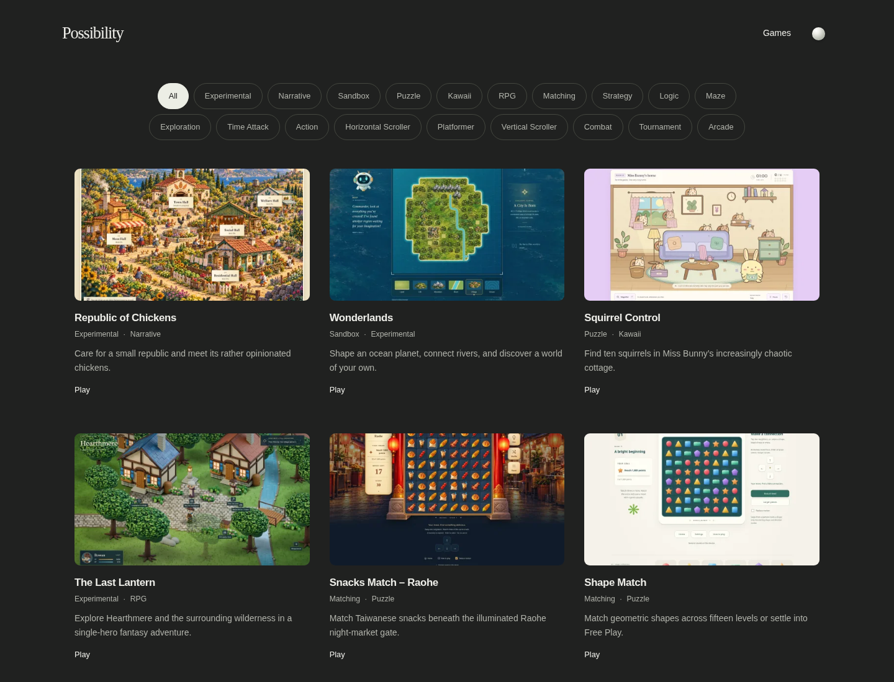
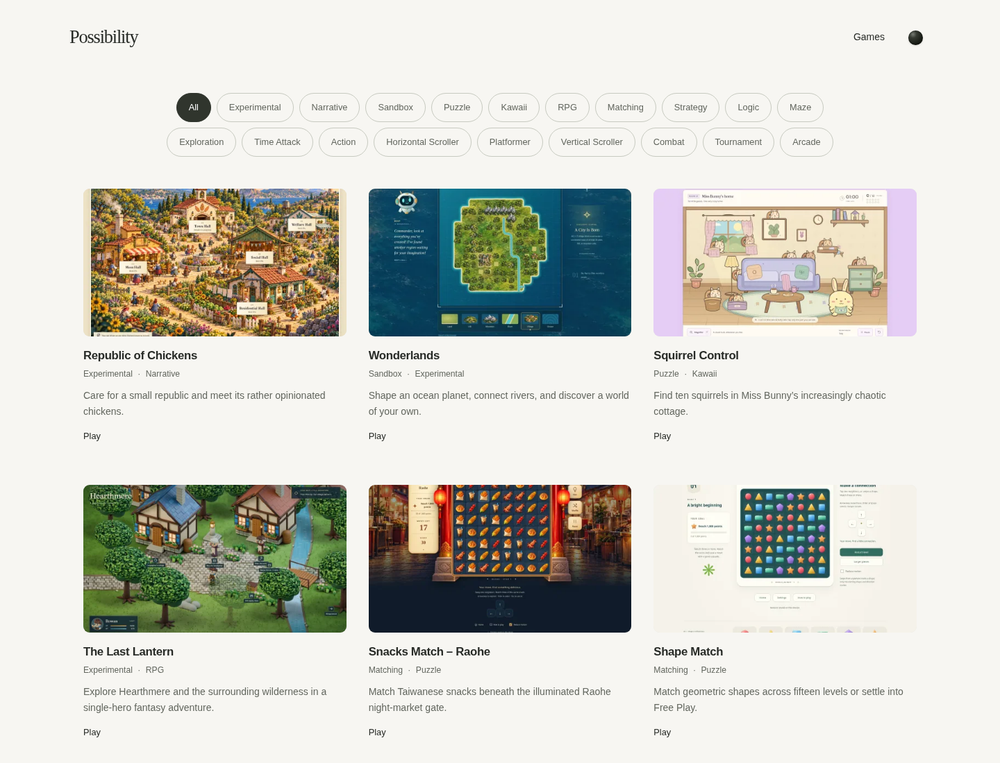

# Possibility Platform v1.0 — review candidate

**Development candidate only. No redesigned public deployment or automatic publication activation.** Branch: `platform/v1-rc`. The current live sunlight site at `56f5a997ef12b66cce4948b770c92bc3e8c5db81` remains the rollback baseline.

## Implemented

- Direct Games homepage, shared compact header, initial dark theme, persisted light/dark selection, and a small glossy orb control. The [textual amendment](textual-design-amendment.md) is the visual authority; no missing mockups were substituted.
- Three/two/one-column borderless gallery, 16:9 responsive images, titles, muted tags, factual descriptions and Play links. Single-selection pills hide entire cards and retain their relative ordering.
- Twenty-two reachable games migrated to independently editable metadata files. The approved first six remain in their provisional order; other entries interleave logic, exploration, action and narrative work. Ordering is ordinary data, not code.
- Sixteen authentic screenshot sources, six neutral monograms. Custom covers automatically override screenshots, which override placeholders. No final cover artwork was generated. New derivatives/checksums are generated at build time.
- `/games/` static compatibility redirect with canonical URL and fallback link; all four historical fact sheets preserved, with matching fact sheets for the other projects.
- Shared Markdown/front-matter engine for Blog and What Now?, shared layout/theme, distinct collection mastheads, automatic indexes/navigation, stable filename-based URLs and omitted drafts. Apps uses the same gallery system. Empty collections produce neither indexes nor navigation.
- Content-only maintenance, safe Markdown rendering, static metadata/sitemap/404, clean-source release packaging, documentation and a prepared **inactive** automatic-publishing workflow.

## Review locally

```sh
npm ci
npm run dev
```

- Homepage: **http://localhost:4173/**
- Compatibility URL: **http://localhost:4173/games/** → `/`
- Preserved example: **http://localhost:4173/games/republic-of-chickens/**

Use the orb to compare themes. The preview binds only to loopback. After editing source/content, restart `npm run dev` or run `npm run build` while the preview server stays running. No public preview service is created.

## Evidence and scope

Run `npm run check` for strict TypeScript, lint/format, catalog/security/publishing integration tests and local Chromium checks. `npm run verify:links` performs normal-TLS checks of published destinations and their HTML-linked resources. `npm run release:check` additionally packages the exact clean commit.

Screenshots and receipts are in `evidence/`; exact-run CI artifacts include `.artifacts/browser/results.json`, `publishing-proof.json`, `asset-evidence.json`, live-link evidence and release manifest/ZIP. The publishing proof records two different fingerprinted output URLs after replacing the same synthetic cover source. Synthetic Blog/What Now?/Apps data exists only in ignored test fixtures and never in production.

Browser checks cover both themes at 320/390/768/1024/1440px, every supplied filter at mobile/desktop widths, routing, no-JavaScript content, keyboard, emulated touch, preference persistence/blocked storage, image failure, reduced motion, forced colors, enlarged text and axe scans. Read the receipt for actual results; no physical-device, Safari/Firefox or screen-reader certification is claimed. Fresh live-game interaction is not claimed by HTTP checks.

| Completed local checks | Result |
| --- | --- |
| TypeScript, lint/format | Passed |
| Catalog/security/publishing tests | 12 passed, including content-only cover replacement and both editorial collections |
| Theme/responsive cases | 10 passed across five widths and both appearances |
| Single-selection filtering | 76 cases passed; complete-card hiding, relative order and gap closure |
| Accessibility | 13 axe scans; zero violations and zero incomplete checks |
| Interaction/resilience | 11 scenarios passed, including runtime cover → screenshot → placeholder failure handling |
| Isolated Apps/editorial routes | Five passed; fixtures excluded from production |
| Publication verifiers | Local browser smoke and byte verification of all 64 public build files passed; this is not redesigned public deployment evidence |
| Destinations/resources | 22 pages + 44 HTML-linked scripts/styles returned HTTP 200; Squirrel Control manifest hash matched |

The committed evidence records local candidate preparation; the successful CI artifact for the exact candidate SHA is authoritative for clean-source release packaging.

## Screenshots and publishing demonstrations

[Desktop dark](evidence/gallery-1440-dark.png) · [Desktop light](evidence/gallery-1440-light.png) · [Mobile dark](evidence/gallery-390-dark.png) · [Mobile light](evidence/gallery-390-light.png) · [Keyboard focus](evidence/keyboard-focus.png)





[Cover replacement and Markdown proof](evidence/publishing-proof.json) · [Browser receipt](evidence/browser-results.json) · [Live-link receipt](evidence/live-links.json) · [What Now? fixture, dark](evidence/what-now-fixture-dark.png) · [What Now? fixture, light](evidence/what-now-fixture-light.png).

To inspect **synthetic, unpublished test content only**, run `npm run check`, then in a separate terminal:

```sh
python3 -m http.server 4176 --bind 127.0.0.1 --directory .artifacts/fixtures/publishing/dist
```

Fixture URLs: **http://localhost:4176/blog/publishing-fixture/** and **http://localhost:4176/what-now/publishing-fixture/**. The fixture home **http://localhost:4176/** uses a clearly synthetic solid-color cover to test the override mechanism. These files are outside the production `dist/` and release ZIP. Draft fixture routes are absent. Never deploy this fixture directory.

## Editorial notes

- The full [migration inventory](migration-inventory.json) distinguishes public reachability, release maturity, image sources and known limits. All 22 pages and 44 HTML-linked script/style resources were freshly reachable during preparation. This is not a claim of universal final creative acceptance.
- Cute Animal Match is publicly available, with final creative acceptance documented as pending; its fact sheet says so. Existing four accepted entries and their evidence remain preserved.
- All supplied tags are retained. **Nom Nom BOOM! / Time Attack** needs editorial review: the game records personal times but has no time limit or losing condition. Kawaii remains provisional for the three supplied assignments. Launch Sequence’s interface emphasizes space controls more than cute illustration; confirm that tag during artwork review. It asserts no age suitability certification. No Commercial, Children or speculative Cozy tag is added.
- Formosa Quest, Jeremy’s Odyssey, Tidelight, Jasmine’s Odyssey, Riot Defender and The Other 90% use neutral placeholders until an authentic screenshot or approved cover is supplied. No broken historical URL is used for Play.
- Historical screenshots may be cropped for the 16:9 preview; these are temporary screenshot fallbacks, not approved promotional covers. Artwork refinement remains independent of platform code.

## Architecture and release boundary

One Node 24/TypeScript build remains. Markdown-it and YAML parse author content; Sharp generates responsive WebP assets. All three are build-time dependencies; no framework, Ruby build, CMS, backend, telemetry or runtime API was introduced. Historical design/prototype evidence remains archived.

[Owner maintenance](../MAINTENANCE.md) · [Catalog/update contract](../CATALOG.md) · [Design modules](../DESIGN.md) · [Assets](../ASSETS.md) · [Separate deployment authorization](../DEPLOYMENT.md).
