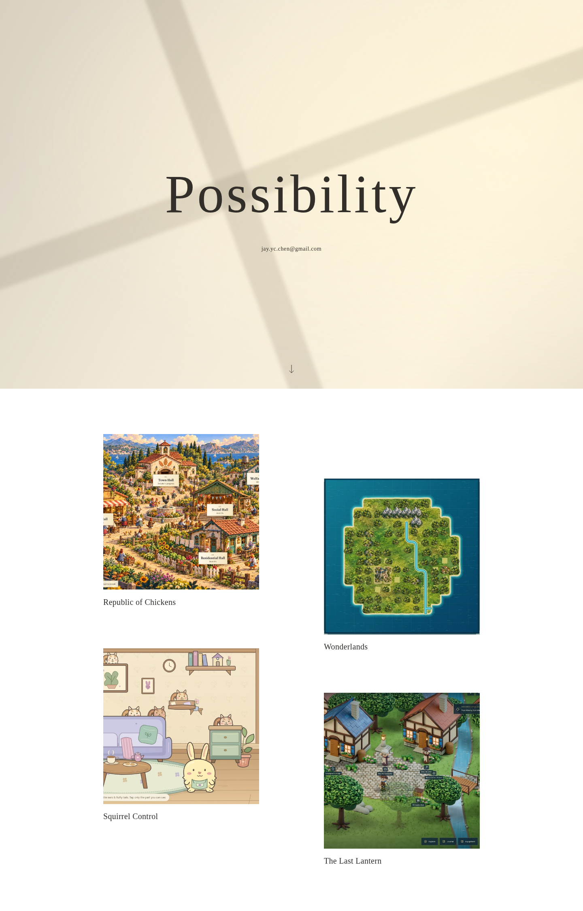

> Historical Stage B preparation report. The subsequent manual deployment of `56f5a997ef12b66cce4948b770c92bc3e8c5db81` succeeded in [run 40493531104](https://github.com/jaychtw/jaychtw.github.io/actions/runs/40493531104). Its earlier “not deployed” statements describe the report-writing time. The new, unpublished platform candidate is documented in [Platform v1.0](../platform-v1/README.md).

# Possibility 1.0.0-rc.1 — Stage B release report

**Stage B production release candidate; public deployment is not authorized or performed.** The creator-approved visual baseline is Stage A.2 Revision 2, **`f99940ec0de18544299f5095890042584b1b1bd7`**. It is design v1.0, not a permanent creative freeze.

## Result

- Living Window sunlight, centered stationary title/email, and native scrolling into the white Drift portfolio retain the approved appearance. The independent `/games/` route works directly and after refresh. No extra homepage/gallery copy, descriptions, menus or controls were introduced.
- Both routes are now prerendered static HTML from one validated, extensible catalog. They render/navigate without JavaScript, GitHub APIs or game-site availability. Optional JavaScript provides honest failed-image fallbacks and pauses offscreen light.
- Four verified released works remain curated: Republic of Chickens, Wonderlands, Squirrel Control and The Last Lantern. Their actual square gameplay crops/provenance are retained locally; no synthetic work, guessed dates, future branches or artificial Recently Added area is published.
- Four directly addressable fact sheets provide concise preview/controls/language/limitations and Play/Source links under `/games/<id>/`. Existing title/image tiles still launch the verified games directly.
- Metadata, canonical URLs, sitemap, robots, favicon, custom 404, a restrictive CSP, fingerprinted assets, static route refresh, reduced motion, keyboard focus, text reflow and missing-art handling are integrated.
- Source, catalog, sunlight, layout, build and enhancements are small replaceable modules. [Refinement guidance](../DESIGN.md) explains how to approve/update future design references without rewriting the site or touching games.

## Validation

Local toolchain: **Node 24.19.0**, Python **3.12.14**, Chromium **154.0.8037.57**, Playwright **1.64.1**, axe **4.14.0**. TypeScript strict checks, ESLint/format checks, **11 catalog/security/render tests**, and the production browser suite passed. [Local browser receipt](evidence/results.json).

| Scope | Actual local result |
| --- | --- |
| Root and `/games/` | 10 route/width cases at 320/390/768/1024/1440px; static content, safe external destinations, square offset cards, reload, no horizontal overflow/overlap/snap and no external runtime requests. |
| Functional resilience/accessibility | 18 behavior cases: four fact-sheet routes, two JavaScript-disabled routes, two reduced-motion cases, real keyboard/focus and emulated touch scrolling, runtime image failure, offscreen pause/resume, short landscape, four 200%-text reflow cases and forced-colors mode. |
| Catalog growth | 25 neutral fixture cases: 3/4/5/8/12 items × five widths. Fixtures are not catalog entries, routes or shipped content. |
| Visual baseline | Two 9-second landing-state comparisons at 390px and 1440px against the frozen approved reference. **Zero changed pixels** in the local run. The fixture is independently maintained, not imported from production CSS. |
| Automated accessibility | Eight axe scans: four root/gallery viewport scans and four fact sheets. **Zero violations.** Two root complex-gradient color-contrast checks were incomplete and are covered by the separate contrast evidence below, not suppressed or mislabeled as axe passes. |
| Contrast | Five viewport cases, 13 rendered phases over 120 seconds; minimum sampled ratio **7.61:1**. A conservative all-phase source-color/full-shadow compositing bound is **5.79:1** for the fixed foreground. This is scoped evidence, not general WCAG certification. |
| Live destinations | Four canonical pages and eight HTML-linked JS/CSS resources returned HTTP 200 using normal TLS. Squirrel Control's public bundle matches its release manifest. [Fresh link receipt](evidence/live-links.json). |
| Publication verifiers | Exact public-file verifier and desktop/mobile browser smoke were exercised against the local production build. They have **not** been run against a published Possibility portal. |

The committed receipt records local preparation. **The successful `Validate release candidate` run for the exact candidate SHA is the release gate**, and its `possibility-review-<SHA>` artifact holds the clean-source ZIP, manifest/SHA-256 and exact-run evidence. CI can use a different installed Chrome version; read that run's result rather than assuming the local browser version. No release ZIP is trusted merely because an older run passed.

A clean local checkout can reproduce it with `npm ci && npm run release:check`. Release packaging refuses uncommitted source, a build from another commit, a missing published launch game, or absent/stale/mismatched public-link evidence. Only generated site output ships; prototype experiments, review docs, original screenshots, test fixtures, dependencies and caches do not.

## Review screenshots

[Desktop continuous page](evidence/home-1440.png) · [Mobile continuous page](evidence/home-390.png) · [Desktop direct gallery](evidence/games-1440.png) · [Mobile direct gallery](evidence/games-390.png) · [Reduced-motion still](evidence/reduced-390.png) · [Keyboard focus](evidence/keyboard-focus.png)

[Approved normal-speed/accelerated motion evidence](../stage-a2/revision-2/README.md) remains representative of the retained sunlight parameters; production additionally pauses invisible light. The site does not use either video as a background.

## Limits and release boundary

No physical-phone, actual Safari/Firefox, screen-reader, sustained GPU/FPS, battery/thermal or field-vitals certification is claimed. System-font metrics and CSS path-morph support can vary; unsupported path morphing retains the static SVG edge shape. Reduced-motion and forced-colors fallbacks were actually checked in Chromium. Root text reflow may wrap the wordmark when necessary under enlarged text; its normal approved appearance is unchanged.

Fresh live-game browser interactions were not rerun from this cloud Chromium because of the previously documented proxy-CA trust limitation. Normal-TLS public reads and original creator/hosted gameplay release evidence support the curated destinations; this does not claim that every transitive game asset or interaction was freshly tested. No trust-store bypass, game modification or another-repository write was performed.

The existing **JC placeholder** remains the public user site until separately authorized publication. No custom domain/Pages setting, public deployment, tag, public GitHub release, game site or standards repository was changed during Stage B. The automatic workflow validates only; the manual publication workflow was prepared but not dispatched.

## Exact next steps

1. Review this exact commit's successful CI run and download `possibility-review-<SHA>`. Verify its ZIP/SHA-256 and retain the manifest/source SHA.
2. Give explicit authorization to deploy **that full SHA**.
3. Follow [the exact manual workflow and verification/rollback steps](../DEPLOYMENT.md). The workflow requests the full SHA and phrase `PUBLISH POSSIBILITY`; pushes never publish.
4. After publication, record the actual URL, source/deployment identity, public file hashes, browser/link checks and outstanding manual/device checks. Do not call the portal publicly released before those steps succeed.

[Catalog and portable future release-update contract](../CATALOG.md) · [Design/refinement architecture](../DESIGN.md) · [Asset provenance](../ASSETS.md).
