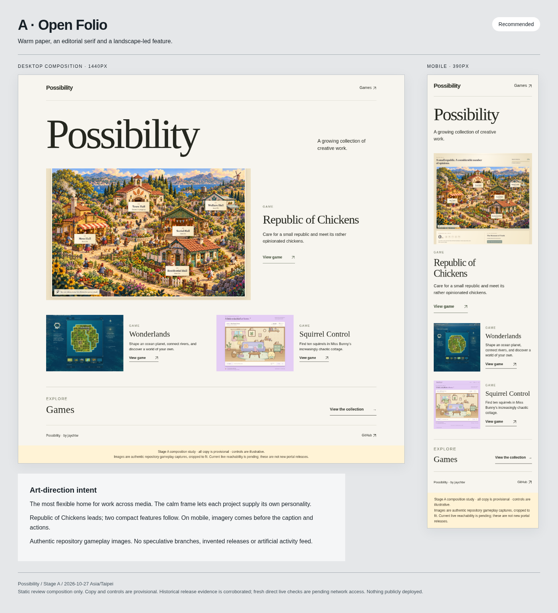
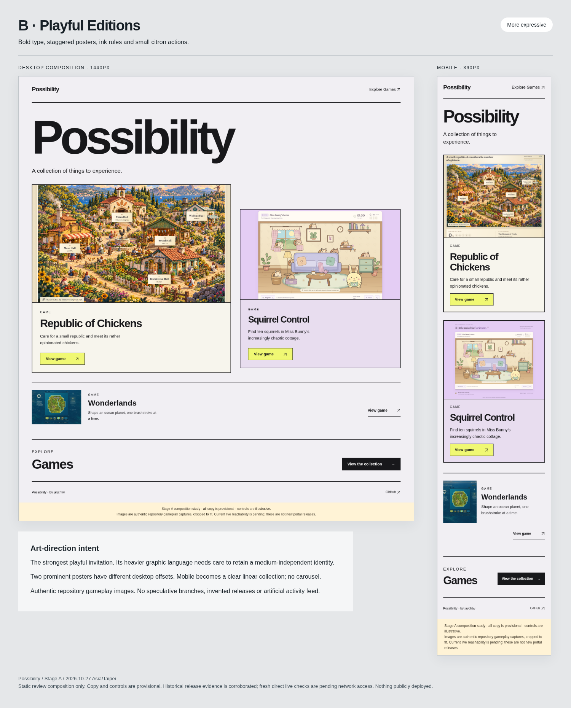
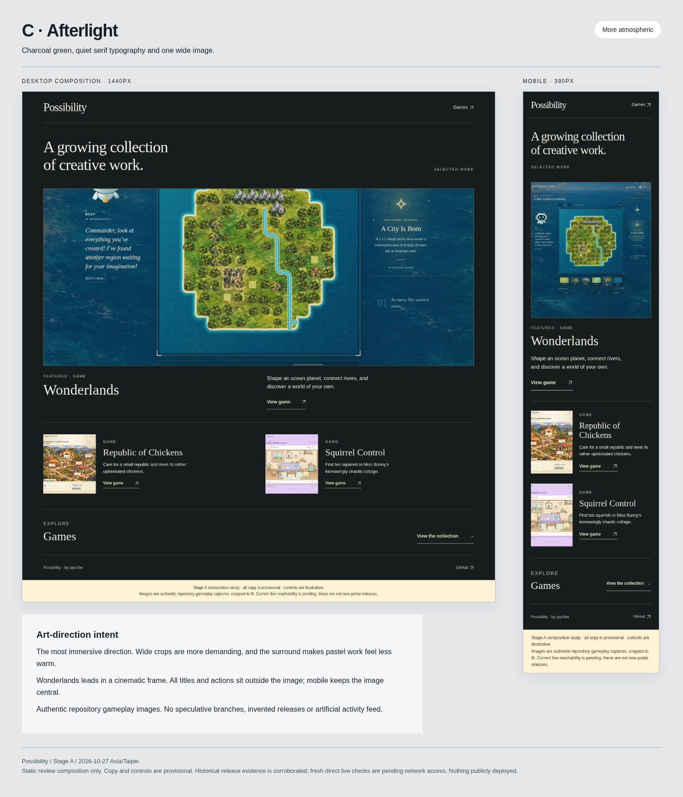

# Possibility — Stage A visual review

**Awaiting visual-direction approval.** These are desktop/mobile art-direction studies using authentic gameplay screenshots. They are not a production portal or release candidate. I recommend **A · Open Folio** for its restrained presentation and flexibility across media.

| Direction | Character | Full-size compositions |
| --- | --- | --- |
| **A · Open Folio — recommended** | Warm paper, editorial serif, generous space. Lets the work lead. | [Desktop](concept-a-1440.png) · [Mobile](concept-a-390.png) · [Board](board-a.png) |
| **B · Playful Editions** | Bold typography, staggered posters, citron accents. More expressive and game-oriented. | [Desktop](concept-b-1440.png) · [Mobile](concept-b-390.png) · [Board](board-b.png) |
| **C · Afterlight** | Charcoal green, cinematic imagery, quiet captions. Atmospheric; crops need care. | [Desktop](concept-c-1440.png) · [Mobile](concept-c-390.png) · [Board](board-c.png) |

## A · Open Folio

## B · Playful Editions

## C · Afterlight

## Audit and implementation proposal

- [Full Stage A report: release evidence, hosting conflicts, architecture and acceptance mapping](STAGE-A-REVIEW.md).
- [Inventory of 25 public repositories](repository-inventory.csv).
- [Authentic screenshot provenance and checksums](asset-provenance.json).
- [Proposed future release-to-portal update contract](RELEASE-TO-PORTAL.md).
- [Composition-check evidence](composition-checks.json) and [browser/version scope](capture-environment.json).
- [Public destination requests and network-policy results](destination-checks.json).
- [Corroborated historical workflow results](run-results.json); the [evidence index](evidence/README.md) links pinned source documents and retained workflow snapshots.

Four shortlisted games have corroborated approval/release records, successful hosted deployments and required public verification steps: Republic of Chickens, Squirrel Control, Wonderlands and The Last Lantern. Fresh live Pages/root checks remain blocked by the cloud network policy. The existing user-site repository contained only a README at the audited commit; its live Pages configuration is not established. See the report for the saved network additions and remaining checks.

The PNGs above can be reviewed directly on GitHub. The accompanying HTML files are static composition sources for optional local/offline review; their action labels are illustrative. No package install is needed to view the PNGs. Source screenshots are retained locally in this directory, not hotlinked at runtime.

## Decision boundary

Choose A, B or C, or request specific revisions. Visual approval authorizes Stage B implementation and testing in this portal repository. Public deployment and edits to another repository still require separate explicit authorization. This documentation commit does not add a deployment workflow or authorize website publication.
