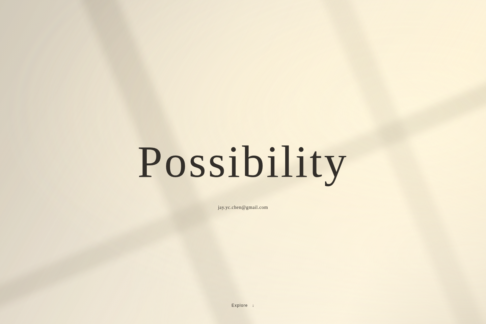
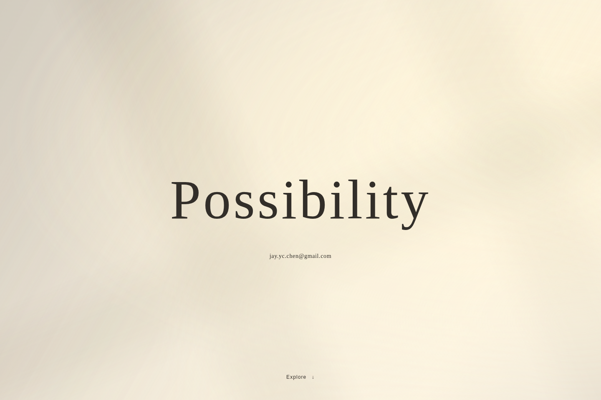
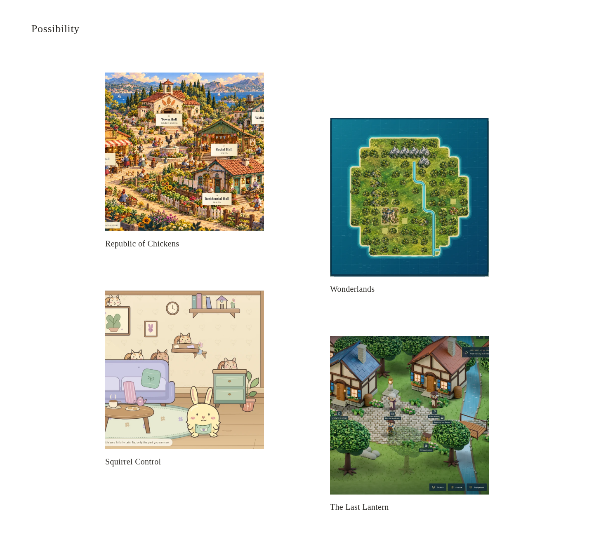
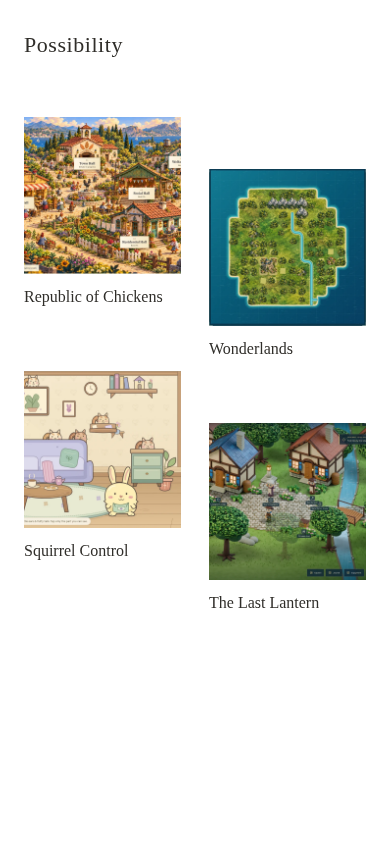
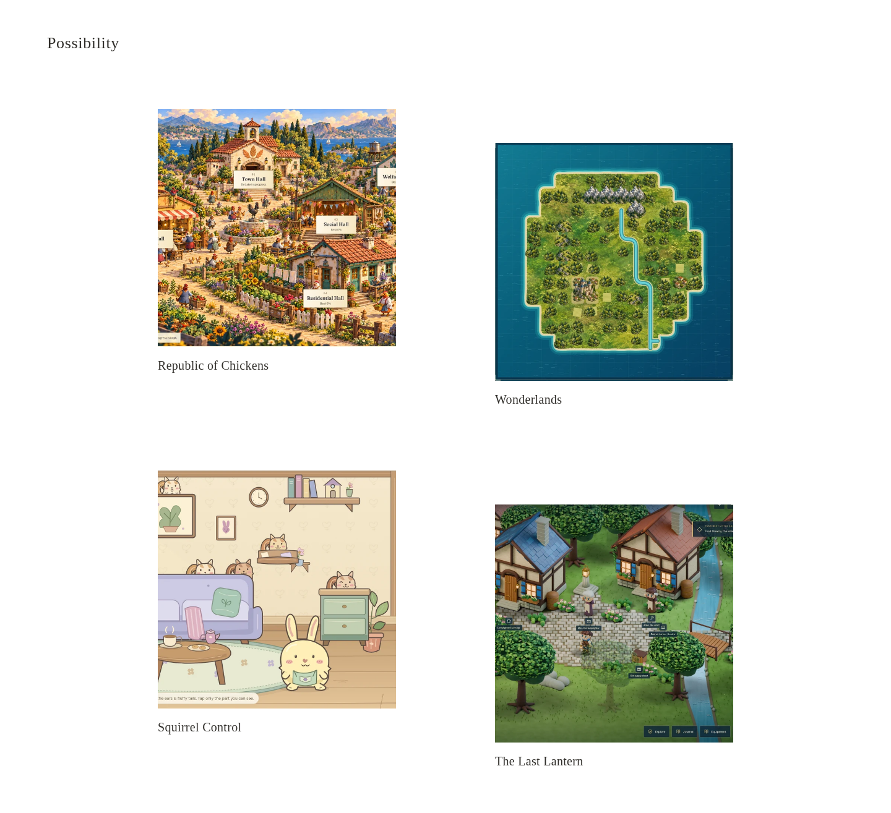

# Possibility — Stage A.2 interactive visual review

**Status: awaiting approval of the light and gallery composition. Stage B has not started.** This follows the [v1.1 visual-pivot handoff](handoff/README.md); the earlier A/B/C boards remain archived exploration.

**Recommended pair: Window light + Drift gallery.** Window makes the architectural source of the light clearer; Drift gives each work more breathing room. Diffuse is gentler and more abstract; Cadence compresses the vertical rhythm slightly. Neither choice adds product controls, copy, projects or decoration.

[Download the standalone local prototype](Possibility-Stage-A2.zip) · [Run/compare instructions](../../prototypes/stage-a2/README.md) · [Watch the 16-second motion proof, 20× playback](evidence/daylight-motion-20x.mp4) · [Implementation notes and actual checks](IMPLEMENTATION-NOTES.md)

The ZIP needs only Python 3 to run locally. These files are committed for review, not published as a website. The existing Pages root and all game repositories remain unchanged.

## Landing light variants — same composition

Only **Possibility**, the exact email link, and a small functional **Explore** link appear. No tagline, biography, project panels or social links.

| Variant | Desktop | Mobile |
| --- | --- | --- |
| **Window — recommended for review** | [1440px](evidence/landing-window-1440.png) | [390px](evidence/landing-window-390.png) |
| Diffuse | [1440px](evidence/landing-diffuse-1440.png) | [390px](evidence/landing-diffuse-390.png) |

### Window

### Diffuse

[Diffuse mobile](evidence/landing-diffuse-390.png) · [Window reduced-motion still](evidence/reduced-window-390.png) · [Diffuse reduced-motion still](evidence/reduced-diffuse-390.png)

The video samples actual browser-rendered CSS motion every two animation seconds, encoded at 10fps, making playback **20× faster**. It shows eight seconds per variant; its labels are review annotations, not website content. The unaccelerated scene takes tens of seconds to shift noticeably. Local instructions describe both normal and reduced-motion review.

## Gallery offset patterns — same four authentic works

White background, square images, titles only. The entire image/title is one accessible link. The wordmark returns to Possibility and retains the selected variants. There is no gallery filter, metadata, date, status badge, description or button.

| Pattern | Desktop | Mobile |
| --- | --- | --- |
| **Drift — recommended for review** | [1440px](evidence/gallery-drift-1440.png) | [390px](evidence/gallery-drift-390.png) |
| Cadence | [1440px](evidence/gallery-cadence-1440.png) | [390px](evidence/gallery-cadence-390.png) |

### Drift

### Cadence

[Cadence mobile](evidence/gallery-cadence-390.png)

The real catalog contains Republic of Chickens, Wonderlands, Squirrel Control and The Last Lantern. The square assets are crops of genuine gameplay screenshots, not mood-board illustrations. [Crop coordinates, pinned sources and checksums](asset-provenance.json).

## Evidence and limits

- **26 local browser cases passed**: landing/gallery variants across 320/390/768/1024/1440px, static reduced motion, actual keyboard/pointer/emulated-touch navigation, reload, focus order and missing-image behavior.
- **50 layout-fixture cases passed** across both patterns, 3/4/5/8/12 items and all five widths, with square images and no overlap/overflow. Neutral fixture tiles exist only inside the test harness; they are not projects or a hidden gallery mode. [Fixture evidence](evidence/README.md).
- **Eight axe scans reported zero violations.** Four landing scans flagged complex-background contrast for review; sampled rendered-pixel checks under all text/link bounds returned a minimum of **9.05:1** over the tested phases. Reduced-motion captures were pixel-identical before/after waiting. This is bounded testing, not WCAG certification or exhaustive continuous-frame proof.
- Four game destinations and eight HTML-linked JS/CSS resources returned **HTTP 200 using normal verified HTTPS**. Squirrel Control's live bundle hash matches its release manifest. Historical acceptance and hosted interaction evidence remain in the Stage A audit. [Fresh HTTPS evidence](evidence/live-https-checks.json).
- Current live-game Chromium interactions were not rerun: this browser rejects the environment proxy CA. Automatic approval review rejected a user-wide trust-store change; no TLS bypass was used. Local POC browser checks are unaffected.
- No physical-device, actual Safari/Firefox, screen-reader or sustained GPU/FPS coverage is claimed.

[Full browser evidence](evidence/browser-checks.json) · [Implementation and performance notes](IMPLEMENTATION-NOTES.md) · [Future release-to-portal contract](../stage-a/RELEASE-TO-PORTAL.md)

## Approval requested

Select **Window or Diffuse** light and **Drift or Cadence** gallery, or request a specific revision. Approval of this pair opens Stage B production. Public portal deployment and changes to another repository still require separate explicit authorization.
