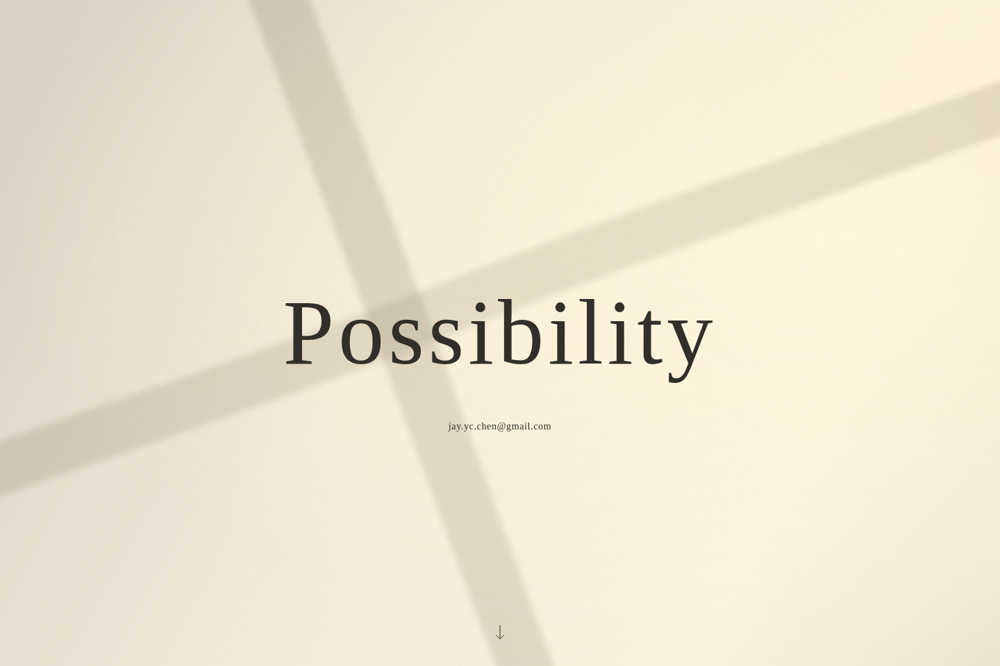
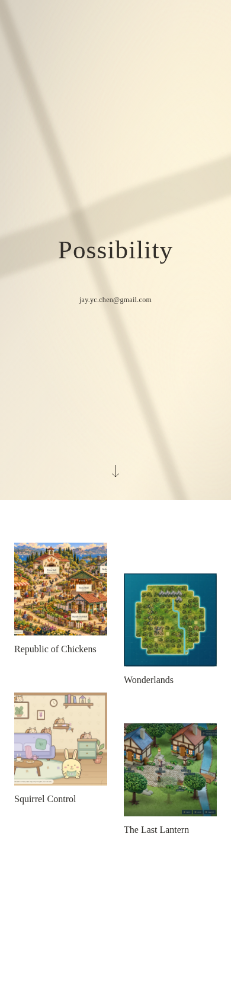

# Possibility — Stage A.2 revision 2: living sunlight and continuous scrolling

**Awaiting approval of this revised direction. No Stage B production or public deployment.**

The first section is a full-viewport sunlit landing with centered, stationary **Possibility**, the email link, and a quiet downward arrow. The white portfolio sits immediately below it on the **same page**, reached by natural scrolling. The separate `/games/` URL remains intact.

[Download the local prototype](Possibility-Stage-A2-Revision-2.zip) · [Exact localhost URLs and instructions](../../../prototypes/stage-a2/README.md) · [Normal-speed 1× proof](evidence/sunlight-normal-1x.mp4) · [Accelerated 10× proof](evidence/sunlight-accelerated-10x.mp4)

## Run locally

From a repository checkout:

```sh
python3 prototypes/stage-a2/serve.py
```

Or extract the ZIP and run `python3 serve.py` inside its folder. No Node install or build is required to experience the prototype.

- http://localhost:8766/ — landing and portfolio on one page.
- http://localhost:8766/games/ — direct portfolio, including refresh.

These addresses work on your computer once the server is running. Default: Window light + Drift gallery. Stop with Ctrl+C. Optional comparisons and alternative port instructions are in the POC README.

## What changed

- Window edges now deform through broad, gentle Bezier-curve changes. Small drift and slow, uneven brightness changes run independently; no noisy ripple field or video background is used.
- The title does not move with the light. The scene is scoped/clipped to its section, so it scrolls away normally and never paints over the white gallery.
- Explore has been removed. A simple arrow is an optional accessible `#portfolio` shortcut; wheel, touch swipe and keyboard scrolling discover work without clicking it.
- Square authentic thumbnails, titles only, deterministic stagger patterns, minimal direct-gallery return navigation and the four curated game destinations are retained. No new content or decorative controls were added.
- Reduced motion disables all light animations while keeping the still composition and ordinary scrolling.

## Visual evidence

[Full desktop continuous page](evidence/continuous-window-1440.png) · [Full mobile continuous page](evidence/continuous-window-390.png) · [Scrolled mobile portfolio](evidence/scrolled-portfolio-390.png) · [Direct desktop gallery](evidence/gallery-drift-1440.png) · [Direct mobile gallery](evidence/gallery-drift-390.png)





The **normal-speed clip is approximately 24 seconds at 1×**, captured with original browser frame timestamps and no animation seeking/speed changes. The separate **12-second accelerated clip is 10×**: 120 seconds of CSS animation sampled once per animation second and encoded at 10fps. Labels are review annotations, not extra website text. Neither recording is an FPS benchmark. [Capture metadata](evidence/motion-proof.json).

## Checks and actual limits

- **35 browser cases passed**, including both routes, two light variants, both gallery patterns and 320/390/768/1024/1440px widths. The first scene occupies a viewport and the gallery follows without a gap/overlay. Title bounding boxes stay identical while edge paths and brightness change.
- Actual wheel scrolling, keyboard PageDown, cue/Tab focus flow, and an emulated touch swipe passed. There is no scroll snap or custom input interception; native scrolling remains usable with reduced motion. Direct `/games/` loads and refreshes.
- **50 layout cases passed** for 3/4/5/8/12 neutral fixture items at five widths across both patterns, with square thumbnails and no overlap/horizontal overflow. Fixtures are not catalog entries.
- **Eight axe scans reported no violations.** Four complex-gradient contrast checks remained marked incomplete by axe, so contrast was separately checked: minimum sampled rendered contrast **7.61:1** over 25 phases/120 seconds, plus a conservative all-phase compositing lower bound of **5.79:1** for this CSS's fixed text, base colors and maximum shadow opacities. This is scoped evidence, not a WCAG certification.
- Reduced-motion screenshots at 390/1440px were pixel-identical before/after waiting; no active light animations remained, and scrolling still worked. [Mobile still](evidence/reduced-390.png), [desktop still](evidence/reduced-1440.png).
- The extracted revision-2 ZIP passed **three browser smoke cases**, including localhost loading, natural same-page scroll, decoded local images, direct-gallery refresh and return navigation.
- All four game pages and eight HTML-linked JS/CSS assets passed fresh normal-TLS HTTPS checks; Squirrel Control's live JavaScript matches its release manifest. These are not fresh game-browser playthroughs or checks of every transitive game asset. [Public-read evidence](evidence/live-https-checks.json).

Browser: **Chromium 154.0.8037.57**, Playwright **1.64.1**, axe **4.14.0**, Linux. No physical phone, actual Safari/Firefox, screen-reader or sustained GPU/FPS coverage is claimed. CSS `d: path(...)` morphing is verified here in Chromium; unsupported engines keep the static SVG edge shape. System fonts may vary by platform.

[Browser/contrast/fixture results](evidence/browser-checks.json) · [Extracted-ZIP smoke](evidence/bundle-smoke.json) · [Bundle checksum](evidence/bundle-manifest.json) · [Authentic asset origins](../asset-provenance.json) · [Future release-update contract](../../stage-a/RELEASE-TO-PORTAL.md)

The initial Playwright recorder required an unavailable media download, so normal-speed evidence uses native Chromium screencast timestamps and the existing system FFmpeg. No download/TLS verification was disabled. The prior live-game Chromium proxy-certificate limitation remains separate from these passing local POC browser checks; verified HTTPS is used for current public reads.

## Approval checkpoint

Please approve the revised living light and continuous landing-to-gallery composition, or request a focused adjustment. The default Window + Drift is a review choice, not recorded approval. Public deployment and other-repository changes still need separate explicit authorization. The existing public root and game repositories are not modified by this review.
